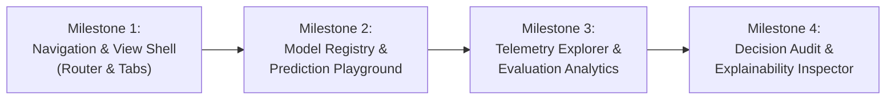

# PhoenixML Phase 3B: Backend API & Frontend Capability Audit
**Dashboard Intelligence & Data Visualization Foundation**
*Audit Date: November 2026 | Baseline Commit: `89e051b` | Working Branch: `dev`*

---

## 1. Executive Summary & Objective

Phase 3A successfully established the dual-theme design system, WCAG AA accessibility compliance, and semantic styling for all existing UI components across PhoenixML.

Phase 3B focuses on **Dashboard Intelligence & Data Visualization**: transforming the dashboard from a static summary card grid into an interactive, data-dense MLOps operations platform.

This audit evaluates the current backend API capabilities, frontend components, state management patterns, and integration gaps to determine:
1. Which existing PhoenixML backend endpoints can be directly exposed in the frontend.
2. What minor backend extensions (e.g. query filters, pagination) are genuinely needed.
3. How to build the six core Phase 3B visual features without introducing heavy third-party dependencies, breaking existing RBAC rules, or violating the human-in-the-loop AIMD paradigm.

---

## 2. Backend API Inventory

The PhoenixML backend is built on **FastAPI**, **SQLAlchemy 2.0 ORM**, **Pydantic v2**, and **PostgreSQL**, with strict role-based access control (`ADMIN`, `ML_ENGINEER`, `VIEWER`).

### 2.1 Complete Endpoint Catalog

| Domain | HTTP Method & Path | Purpose | Required Role | Request Payload / Params | Response Structure | Implementation Status |
|---|---|---|---|---|---|---|
| **Health** | `GET /api/health` | Service health probe | Public | None | `{"status": "ok", "project": "PhoenixML"}` | **Implemented** |
| **Auth** | `POST /api/auth/register` | Register new user account | Public | `UserCreate` (username, email, password) | `UserRegisterResponse` (user info, default `VIEWER` role) | **Implemented** |
| **Auth** | `POST /api/auth/login` | Authenticate & retrieve JWT | Public | `OAuth2PasswordRequestForm` (username, password) | `Token` (access_token, refresh_token, token_type) | **Implemented** |
| **Auth** | `POST /api/auth/refresh` | Rotate access token | Public | `RefreshTokenRequest` (refresh_token) | `AccessTokenResponse` (access_token, token_type) | **Implemented** |
| **Auth** | `POST /api/auth/logout` | Revoke session (client discard) | Authenticated | None | `LogoutResponse` (acknowledgement message) | **Implemented** |
| **Users** | `GET /api/users/me` | Fetch authenticated user profile | Authenticated | None | `UserRead` (id, username, email, role, is_active, created_at) | **Implemented** |
| **Users** | `PATCH /api/users/me` | Update non-sensitive profile fields | Authenticated | `UserProfileUpdate` (full_name, username, email) | `UserRead` | **Implemented** |
| **Users** | `POST /api/users/me/change-password` | Change user password | Authenticated | `UserPasswordChange` (current_password, new_password) | `{"message": "Password changed successfully"}` | **Implemented** |
| **Registry** | `POST /api/spam-models` | Register new spam model | `ADMIN`, `ML_ENGINEER` | `ModelCreate` (name, framework, algorithm, description, status) | `ModelRead` (id, owner_id, created_at, updated_at, ...) | **Implemented** |
| **Registry** | `GET /api/spam-models` | List registered models (paginated) | `ADMIN`, `ML_ENGINEER`, `VIEWER` | Query: `skip` (int, default 0), `limit` (int, 1-100) | `List[ModelRead]` (scoped to owned models unless `ADMIN`) | **Implemented** |
| **Registry** | `GET /api/spam-models/{model_id}` | Fetch single registered model details | `ADMIN`, `ML_ENGINEER`, `VIEWER` | Path: `model_id` (UUID) | `ModelRead` | **Implemented** |
| **Registry** | `PUT /api/spam-models/{model_id}` | Update model metadata or status | `ADMIN`, `ML_ENGINEER` | Path: `model_id`, Body: `ModelUpdate` (name, description, status) | `ModelRead` | **Implemented** |
| **Registry** | `DELETE /api/spam-models/{model_id}` | Delete registered model and cascading telemetry | `ADMIN`, `ML_ENGINEER` | Path: `model_id` (UUID) | HTTP 204 No Content | **Implemented** |
| **Inference** | `POST /api/spam-models/{model_id}/predict` | Run deterministic model inference on text | `ADMIN`, `ML_ENGINEER`, `VIEWER` | Path: `model_id`, Body: `PredictionInput` (`text`) or `BatchPredictionInput` (`texts`) | `BatchPredictionResponse` (model_id, total, spam_count, ham_count, `predictions: List[PredictionResult]`) | **Implemented** |
| **Inference / Eval** | `POST /api/spam-models/{model_id}/evaluate-telemetry` | Run reference or shifted evaluation & record telemetry | `ADMIN`, `ML_ENGINEER` | Path: `model_id`, Body: `LabeledEvaluationInput` (`dataset_name`: 'reference'/'shifted', `sample_limit`, `use_reference_test_set`) | `TelemetryEvaluationResponse` (`metrics: EvaluationMetricsResult`, `observation_id`, `observation_recorded`) | **Implemented** |
| **Monitoring** | `POST /api/spam-models/{model_id}/monitoring` | Manually record monitoring observation | `ADMIN`, `ML_ENGINEER` | Path: `model_id`, Body: `MonitoringObservationCreate` (`observed_at`, counts, metrics) | `MonitoringObservationRead` | **Implemented** |
| **Monitoring** | `GET /api/spam-models/{model_id}/monitoring` | List historical monitoring observations | `ADMIN`, `ML_ENGINEER`, `VIEWER` | Path: `model_id`, Query: `skip` (default 0), `limit` (1-100) | `List[MonitoringObservationRead]` (ordered newest first) | **Implemented** |
| **Monitoring** | `GET /api/spam-models/{model_id}/monitoring/{observation_id}` | Retrieve specific observation | `ADMIN`, `ML_ENGINEER`, `VIEWER` | Path: `model_id`, `observation_id` | `MonitoringObservationRead` | **Implemented** |
| **Monitoring** | `DELETE /api/spam-models/{model_id}/monitoring/{observation_id}` | Delete specific observation | `ADMIN`, `ML_ENGINEER` | Path: `model_id`, `observation_id` | HTTP 204 No Content | **Implemented** |
| **Decisions** | `GET /api/spam-models/{model_id}/decisions` | Paginated AIMD decision history | `ADMIN`, `ML_ENGINEER`, `VIEWER` | Path: `model_id`, Query: `skip`, `limit` | `DecisionHistoryResponse` (`model_id`, `total`, `items: List[DecisionLogRead]`) | **Implemented** |
| **Decisions** | `GET /api/spam-models/{model_id}/decisions/{decision_id}` | Fetch single decision log detail | `ADMIN`, `ML_ENGINEER`, `VIEWER` | Path: `model_id`, `decision_id` | `DecisionLogRead` (includes `rationale`, `explanation`, `supporting_signals`) | **Implemented** |
| **Decisions** | `PATCH /api/spam-models/{model_id}/decisions/{decision_id}/approval` | Update human approval status | `ADMIN`, `ML_ENGINEER` (Viewer rejected in service) | Path: `model_id`, `decision_id`, Body: `DecisionApprovalUpdate` (`approval_status`: 'APPROVED'/'REJECTED') | `DecisionLogRead` | **Implemented** |
| **Decisions** | `POST /api/spam-models/{model_id}/decisions/evaluate` | Trigger AIMD recommendation engine across telemetry | `ADMIN`, `ML_ENGINEER` | Path: `model_id`, Optional Body: `ModelEvaluationRequest` (drift inputs, context) | `DecisionLogRead` (persisted with `requires_human_approval=True`, `status=PENDING`) | **Implemented** |
| **Dashboard** | `GET /api/dashboard` | Consolidated fleet/user dashboard metrics | `ADMIN`, `ML_ENGINEER`, `VIEWER` | Query: `model_id` (optional filter) | `DashboardOverviewResponse` (models_summary, monitoring_summary, health_summary, decision_summary, model_cards) | **Implemented** |
| **Dashboard** | `GET /api/dashboard/{model_id}` | Focused single-model dashboard overview | `ADMIN`, `ML_ENGINEER`, `VIEWER` | Path: `model_id` | `DashboardOverviewResponse` | **Implemented** |

### 2.2 Deep-Dive into Analytical Data Models

#### 1. Evaluation & Confusion Matrix Metrics (`EvaluationMetricsResult`)
Located in `app/models/inference_schemas.py`:
- `accuracy`: float `[0.0, 1.0]`
- `precision`: float `[0.0, 1.0]`
- `recall`: float `[0.0, 1.0]`
- `f1_score`: float `[0.0, 1.0]`
- `prediction_count`: int
- `positive_prediction_count`: int (predicted spam)
- `negative_prediction_count`: int (predicted ham)
- `true_positives` (TP): int
- `false_positives` (FP): int
- `true_negatives` (TN): int
- `false_negatives` (FN): int
*Finding: The backend already computes and returns the complete 2x2 confusion matrix during real evaluations.*

#### 2. Monitoring Observations (`MonitoringObservationRead`)
Located in `app/models/monitoring_schemas.py`:
- `id`: UUID
- `model_id`: UUID
- `observed_at`: datetime (timezone-aware)
- `prediction_count`: int
- `positive_prediction_count`: int
- `negative_prediction_count`: int
- `accuracy`: Optional[float]
- `precision`: Optional[float]
- `recall`: Optional[float]
- `f1_score`: Optional[float]
*Finding: All time-series data points needed for accuracy, precision, recall, F1, and traffic trends exist in the database.*

#### 3. Explainability & Supporting Signals (`ExplanationResult` & `DecisionLogRead`)
Located in `app/monitoring/explainability.py` and `app/decisions/schemas.py`:
- `rationale`: Non-empty human-readable summary of why the AIMD recommendation was made.
- `explanation`: Detailed synthesized diagnostic narrative.
- `supporting_signals`: JSON dictionary storing contributing signals:
  - Category: `health`, `performance`, `concept_drift`, `data_drift`.
  - Severity: `critical`, `warning`, `info`.
  - Evidence: specific metric shifts, p-values, or degraded dimensions.
*Finding: PhoenixML stores rich, structured explanatory signals with every decision. The frontend currently only displays the plain text `rationale` and `explanation`, leaving `supporting_signals` unrendered.*

---

## 3. Frontend Capability Audit

### 3.1 Technology Stack & Assets
- **Runtime**: React 18.3.1, ReactDOM 18.3.1.
- **Build Tool**: Vite 8.3.6 (outputs single CSS and JS bundle to `dist/assets/`).
- **Icons**: `lucide-react` 1.70.0.
- **Utilities**: `clsx`, `tailwind-merge` (via `cn()` helper in `lib/utils.js`).
- **Theme**: Semantic CSS custom properties with live dark/light switching via `data-theme`.
- **Charting Dependencies**: **None installed**.

### 3.2 Existing Frontend Component Inventory

| Component | Path | Purpose | Extensibility for Phase 3B |
|---|---|---|---|
| `AppLayout` / `DashboardLayout` | `layouts/DashboardLayout.jsx` | Top shell with header, sidebar, and toast container | Has `currentView` in local state; currently only renders children (`DashboardPage`). Ready to become a view router. |
| `AppSidebar` | `components/AppSidebar.jsx` | Navigation with 5 tabs: Fleet Overview, Model Registry, Human Approvals, Model Telemetry, Audit Trail | All 5 tabs exist with icons and badges. Needs callbacks wired to switch active view. |
| `AppHeader` | `components/AppHeader.jsx` | Brand title, user role badge, refresh button, theme toggle, logout | Complete and stable. |
| `PageHeader` | `components/PageHeader.jsx` | Reusable view header with title, subtitle, icon, and optional action/badge | Reusable across all Phase 3B views. |
| `KPIGrid` | `components/KPIGrid.jsx` | 4-card metric grid (Models, Observations, Health, Approvals) | Reusable; can be adapted for page-specific KPI overviews. |
| `MetricCard` | `components/MetricCard.jsx` | Single metric card with icon, value, badge, and subtext | Reusable metric tile. |
| `ModelCard` | `components/ModelCard.jsx` | Fleet model card with health bar, metrics, eval buttons, and decision snippet | Contains trigger buttons for reference/shifted evaluation. |
| `DecisionReviewBox` | `components/DecisionReviewBox.jsx` | Dedicated AIMD decision review card with approve/reject actions | Already handles human approval workflows; can be integrated into the Audit Explorer. |
| `RecentDecisionsTable` | `components/RecentDecisionsTable.jsx` | Audit table showing latest 10 decisions | Ready to be generalized into a full paginated table with filters. |
| `DataTable` | `components/DataTable.jsx` | Accessible semantic table with `scope="col"` headers | Foundational table component for all new tabular views. |
| `HealthIndicator` | `components/HealthIndicator.jsx` | Health score progress meter with accessible progressbar attributes | Reusable across models and telemetry views. |
| `HITLBanner` | `components/HITLBanner.jsx` | Top banner notifying operators of pending approvals | Global advisory indicator. |
| `StatusBadge` | `components/StatusBadge.jsx` | Semantic color badge for roles, statuses, and priorities | Reusable across all views. |
| `ConfirmationDialog` | `components/ConfirmationDialog.jsx` | Accessible modal dialog with focus trap and Escape handler | Reusable for model registration, deletion, and approval confirmations. |
| `Toast` / `ToastContainer` | `components/Toast.jsx` | Accessible notifications with live-region politeness | Global notification system. |
| `LoadingState` | `components/LoadingState.jsx` | Centered loading spinner with accessible `role="status"` | Consistent loading state. |
| `EmptyState` | `components/EmptyState.jsx` | Icon, heading, and description for empty collections | Consistent empty state. |
| `ErrorState` | `components/ErrorState.jsx` | Error alert with optional retry action | Consistent error state. |

### 3.3 Existing API Client (`frontend/src/api.js`)
Currently implements:
- `api.login(username, password)`
- `api.register({ username, email, password })`
- `api.getProfile()`
- `api.getDashboardOverview(modelId)`
- `api.evaluateModelTelemetry(modelId, payload)`
- `api.evaluateModel(modelId)`
- `api.updateApprovalStatus(modelId, decisionId, approvalStatus)`
- `api.logout()`

**Missing API Client Methods Needed for Phase 3B**:
- `api.predict(modelId, text)` -> `POST /api/spam-models/{modelId}/predict`
- `api.listModels(skip, limit)` -> `GET /api/spam-models`
- `api.createModel(payload)` -> `POST /api/spam-models`
- `api.updateModel(modelId, payload)` -> `PUT /api/spam-models/{modelId}`
- `api.deleteModel(modelId)` -> `DELETE /api/spam-models/{modelId}`
- `api.getModelObservations(modelId, skip, limit)` -> `GET /api/spam-models/{modelId}/monitoring`
- `api.getDecisionHistory(modelId, skip, limit)` -> `GET /api/spam-models/{modelId}/decisions`

---

## 4. Backend-to-Frontend Capability Mapping

| Backend Capability | Existing Backend Endpoint | Existing Frontend Presence | Integration Gap / Work Needed |
|---|---|---|---|
| **Fleet Overview** | `GET /api/dashboard` | `DashboardPage.jsx` | Fully integrated. |
| **User Profile & Session** | `GET /api/users/me`, `POST /api/auth/*` | `LoginPage.jsx`, `SignupPage.jsx`, `useAuth.js` | Fully integrated. Password change modal not yet surfaced. |
| **Model CRUD** | `POST/GET/PUT/DELETE /api/spam-models` | Models displayed via `getDashboardOverview` only | **GAP**: No create, edit, or delete UI. No dedicated registry view. |
| **Historical Telemetry** | `GET /api/spam-models/{id}/monitoring` | Only latest observation displayed on KPI/Card | **GAP**: Time-series observation list not fetched; no charts. |
| **Real Model Evaluation** | `POST /api/spam-models/{id}/evaluate-telemetry` | Reference/Shifted buttons on `ModelCard.jsx` | Partially integrated (returns raw text banner). Missing visual confusion matrix. |
| **Inference / Prediction** | `POST /api/spam-models/{id}/predict` | None | **GAP**: Prediction endpoint completely unexposed in UI. |
| **Explainability Signals** | `DecisionLogRead.supporting_signals` | Text-only `explanation` in `DecisionReviewBox` | **GAP**: Structured signal cards and evidence breakdown not rendered. |
| **AIMD Evaluation Trigger** | `POST /api/spam-models/{id}/decisions/evaluate` | Button on `ModelCard.jsx` | Integrated. |
| **Human Approval Actions** | `PATCH /api/spam-models/{id}/decisions/{id}/approval` | Buttons on `DecisionReviewBox.jsx` | Integrated. |
| **Decision Audit History** | `GET /api/spam-models/{id}/decisions` | Top 10 recent decisions in `RecentDecisionsTable` | **GAP**: Full paginated decision history and filters not exposed. |

---

## 5. Phase 3B Six-Feature Gap Analysis

### Feature A: Model Telemetry Explorer
- **Concept**: Interactive time-series performance charts tracking accuracy, precision, recall, F1-score, health score, and prediction volumes over historical observations.
- **Backend Status**: **Partial**.
  - `GET /api/spam-models/{model_id}/monitoring?skip=0&limit=100` returns the historical observations in chronological sequence.
  - Minor extension required: Allow sorting ascending/descending and optional date filtering (`start_date`, `end_date`), or perform client-side chronological sorting for charting.
- **Frontend Status**: **Missing**.
  - No chart rendering component exists.
  - No telemetry page exists.
- **Required Work**:
  1. Add `api.getModelObservations(modelId, { skip, limit })` to `api.js`.
  2. Implement a zero-dependency, lightweight React SVG line-chart / area-chart component adhering to semantic CSS chart variables (`--chart-production`, `--chart-baseline`, `--chart-grid`, `--chart-shifted`).
  3. Create `TelemetryExplorerPage.jsx` with model selector, metric toggles (F1, Accuracy, Precision, Recall, Health), and observation data table.
- **Dependencies & Technical Risks**:
  - Must avoid heavy charting libraries (e.g. Chart.js, Recharts) that bloat bundle size or fight with theme tokens. A native SVG path generator (`path d="..."`) is clean, deterministic, and supports both dark and light modes seamlessly.
- **Priority**: **High (Core Phase 3B feature)**.

---

### Feature B: Evaluation Analytics
- **Concept**: Deep evaluation analytics displaying the complete 2x2 confusion matrix (TP, FP, TN, FN), comparison between reference holdout performance and operational shifted dataset performance, and metric degradation deltas.
- **Backend Status**: **Ready**.
  - `POST /api/spam-models/{model_id}/evaluate-telemetry` already calculates and returns `EvaluationMetricsResult` containing `true_positives`, `false_positives`, `true_negatives`, `false_negatives`, accuracy, precision, recall, and F1.
  - Supports both `dataset_name: 'reference'` and `dataset_name: 'shifted'`.
- **Frontend Status**: **Partial**.
  - `ModelCard.jsx` triggers the evaluations and displays compact text snippets.
- **Required Work**:
  1. Build a semantic `ConfusionMatrix.jsx` component displaying a clean 2x2 grid (Predicted Spam vs Actual Spam, Predicted Ham vs Actual Ham) with counts, rates, and theme-aware contrast.
  2. Build an `EvaluationComparisonCard.jsx` displaying side-by-side Reference vs Shifted metrics with delta badges (e.g. `-24.3% degradation in F1`).
  3. Surface these components directly within a focused evaluation panel or within the Telemetry view.
- **Dependencies & Technical Risks**:
  - Pure presentation work. Low technical risk; backend already provides 100% of the numbers.
- **Priority**: **High (High visual & analytical value)**.

---

### Feature C: Model Registry Management
- **Concept**: Dedicated model registry view allowing operators to list, inspect, register new models, update model metadata/status, and archive/delete models with role-based action gating.
- **Backend Status**: **Ready**.
  - Full CRUD REST endpoints (`POST`, `GET`, `PUT`, `DELETE` `/api/spam-models`) are already implemented with strict RBAC.
- **Frontend Status**: **Missing**.
  - Models are only viewable as cards on the main dashboard.
- **Required Work**:
  1. Add `api.listModels()`, `api.createModel()`, `api.updateModel()`, `api.deleteModel()` to `api.js`.
  2. Create `ModelRegistryPage.jsx` featuring a searchable, filterable `DataTable` of registered models.
  3. Create `RegisterModelDialog.jsx` and `EditModelDialog.jsx` reusing `ConfirmationDialog`.
  4. Enforce role constraints: Viewer sees disabled/hidden create and delete controls.
- **Dependencies & Technical Risks**:
  - Low risk; standard CRUD pattern reusing existing dialog and table components.
- **Priority**: **Medium-High (Empowers fleet governance)**.

---

### Feature D: Prediction Playground
- **Concept**: Interactive testing console where operators can enter custom SMS messages (or choose from preset templates) to observe instant classification (spam vs ham), confidence scores, and probability breakdown from the loaded reference model.
- **Backend Status**: **Ready**.
  - `POST /api/spam-models/{model_id}/predict` is fully functional and supports single or batch predictions.
- **Frontend Status**: **Missing**.
  - Endpoint is not surfaced anywhere in the UI.
- **Required Work**:
  1. Add `api.predict(modelId, text)` to `api.js`.
  2. Create `PredictionPlayground.jsx` featuring:
     - Model selection dropdown.
     - Text input area with character counter.
     - Preset sample buttons (e.g. "Obvious Spam", "Urgent Prize", "Normal Personal", "Meeting Reminder").
     - Output card displaying classification badge (`SPAM` / `HAM`), confidence gauge, and spam/ham probability progress bars.
     - Clear disclaimer: *"Inference executed by reference TF-IDF + Logistic Regression artifact. Real-time inference does not modify model weights."*
- **Dependencies & Technical Risks**:
  - Very low risk; backend inference executes in <10ms.
- **Priority**: **High (Interactive showcase of genuine ML capability)**.

---

### Feature E: Explainability Inspector
- **Concept**: Structured visualization of model diagnostic signals, primary driving factors, and drift evidence associated with AIMD recommendations.
- **Backend Status**: **Partial**.
  - System-level explainability is fully supported: `ExplainabilityAnalyzer` generates `ExplanationResult` which is persisted into `DecisionLog.supporting_signals` and `explanation`.
  - Feature-level token weights for individual predictions are not exposed via a dedicated REST endpoint (standard scikit-learn pipeline coefficients are inside the `.joblib` artifact).
- **Frontend Status**: **Partial**.
  - `DecisionReviewBox.jsx` prints the raw explanation string.
- **Required Work**:
  1. Create `ExplainabilitySignalsCard.jsx` to unpack `decision.supporting_signals` into categorized signal badges (`health`, `performance`, `concept_drift`, `data_drift`), severity pills (`critical`, `warning`, `info`), and evidence tables.
  2. Display primary contributing factors (e.g. "F1 score dropped below warning threshold (68.5% < 80.0%)", "Distribution shift detected in message length").
  3. Ensure zero fabrication: If a model has zero decisions or no explanation recorded, clearly display an `EmptyState` explaining that no diagnostic signals are currently recorded.
- **Dependencies & Technical Risks**:
  - Must respect scientific limitation statement: explanations are operational diagnostic signals, not formal causal proofs.
- **Priority**: **Medium (Complements Decision Audit Explorer)**.

---

### Feature F: Decision Audit Explorer
- **Concept**: Comprehensive, searchable, and filterable audit trail of all historical AIMD maintenance recommendations, operator approvals, rejections, and rationales.
- **Backend Status**: **Partial**.
  - `GET /api/spam-models/{model_id}/decisions` supports pagination via `skip` and `limit`.
  - Minor gap: Does not have query parameters for filtering by approval status (`PENDING`, `APPROVED`, `REJECTED`) or priority (`CRITICAL`, `HIGH`, `MEDIUM`, `LOW`). Sorting is fixed to newest-first.
- **Frontend Status**: **Partial**.
  - `RecentDecisionsTable.jsx` shows top 10 decisions from dashboard overview.
- **Required Work**:
  1. Add `api.getDecisionHistory(modelId, { skip, limit })` to `api.js`.
  2. Create `DecisionAuditPage.jsx` with:
     - Model scope filter.
     - Approval status filter tabs (`All`, `Pending Review`, `Approved`, `Rejected`).
     - Search by recommendation action or keyword.
     - Detailed decision drawer or modal to view full rationale and explainability signals.
     - Pagination controls (`Previous`, `Next`, page indicators).
- **Dependencies & Technical Risks**:
  - Low risk; data already exists in PostgreSQL `decision_logs` table.
- **Priority**: **High (Essential for MLOps compliance and governance)**.

---

## 6. Architecture & Implementation Constraints

1. **Preserve Dual-Theme Semantic Design System**:
   - All new components must strictly use tokens defined in `DESIGN.md` and `dashboard.css` (`var(--bg-card)`, `var(--text-primary)`, `var(--border-color)`, `var(--chart-production)`, etc.).
   - No hardcoded hex codes, inline presentation styles, or Tailwind utility classes.
2. **Zero External Charting Bloat**:
   - Implement custom React SVG charting primitives (line, area, bar, gauge).
   - Keeps bundle size tiny (~45 kB CSS, ~230 kB JS), ensures 100% theme reactivity via CSS variables, and avoids npm dependency security vulnerabilities.
3. **Preserve Human-in-the-Loop Governance**:
   - AIMD recommendations must always require explicit operator authorization (`APPROVED` / `REJECTED`).
   - The UI must never claim or simulate autonomous model retraining, deployment, or threshold modification.
4. **Strict Truth in Telemetry**:
   - No mock or randomized metric generators in production code.
   - All charts, confusion matrices, and metrics must directly reflect real `MonitoringObservation` and `DecisionLog` database records.
5. **Role-Based Access Control Compliance**:
   - `VIEWER`: Read-only access across all views. Create, edit, delete, evaluate, and approve buttons must be cleanly disabled with informative tooltips or hidden.
   - `ML_ENGINEER`: Can manage owned models and execute evaluations.
   - `ADMIN`: Unrestricted fleet management.

---

## 7. Recommended Implementation Order & Proposed Milestones

To ensure incremental delivery with zero regressions, Phase 3B is structured into 4 sequential milestones:

### Milestone 1: Multi-View Application Shell & Navigation
- **Goal**: Transform `DashboardLayout.jsx` into a view router driven by `AppSidebar.jsx`.
- **Scope**:
  - Lift `currentView` to `App.jsx` (`'dashboard'`, `'models'`, `'telemetry'`, `'playground'`, `'audit'`).
  - Connect all 5 sidebar buttons so clicking switches the active view seamlessly.
  - Preserve URL/view state across page refreshes.

### Milestone 2: Model Registry Management & Prediction Playground
- **Goal**: Full lifecycle model governance and interactive model testing.
- **Scope**:
  - Expose Model CRUD APIs in `api.js`.
  - Implement `ModelRegistryView.jsx` (model listing, create dialog, edit dialog, delete dialog).
  - Implement `PredictionPlayground.jsx` (live SMS text classification, preset samples, confidence meter).

### Milestone 3: Model Telemetry Explorer & Evaluation Analytics
- **Goal**: Real-time performance time-series charting and confusion matrix analytics.
- **Scope**:
  - Build dependency-free React SVG `TimeSeriesChart.jsx` and `ConfusionMatrix.jsx`.
  - Implement `TelemetryExplorerView.jsx` (historical accuracy, precision, recall, F1, and traffic volume charts).
  - Implement `EvaluationAnalyticsPanel.jsx` (Reference vs Shifted evaluation comparison with degradation delta indicators).

### Milestone 4: Decision Audit Explorer & Explainability Inspector
- **Goal**: Deep governance audit trail and diagnostic explainability signals.
- **Scope**:
  - Expose paginated decision history in `api.js`.
  - Implement `DecisionAuditView.jsx` (paginated table, filter by approval status and priority, keyword search).
  - Implement `ExplainabilitySignalsCard.jsx` (unpacks `supporting_signals` into categorized diagnostic cards).
  - End-to-end live Edge browser dual-theme verification and automated test expansion.

---

## 8. Exact Files Likely to be Modified in Phase 3B

### Frontend New Files:
- `frontend/src/pages/ModelRegistryPage.jsx`
- `frontend/src/pages/TelemetryExplorerPage.jsx`
- `frontend/src/pages/PredictionPlaygroundPage.jsx`
- `frontend/src/pages/DecisionAuditPage.jsx`
- `frontend/src/components/charts/TimeSeriesChart.jsx`
- `frontend/src/components/charts/ConfusionMatrix.jsx`
- `frontend/src/components/ExplainabilitySignalsCard.jsx`
- `frontend/src/components/RegisterModelDialog.jsx`
- `frontend/src/components/EditModelDialog.jsx`

### Frontend Modified Files:
- `frontend/src/api.js` (add model CRUD, predict, monitoring observation list, and decision history client methods)
- `frontend/src/App.jsx` (wire active view navigation from sidebar)
- `frontend/src/layouts/DashboardLayout.jsx` (delegate navigation to view router)
- `frontend/src/components/AppSidebar.jsx` (add Prediction Playground nav item and active state indicators)
- `frontend/styles/dashboard.css` (add scoped styling for charts, matrix grid, and playground)
- `frontend/src/test/components.test.jsx` (unit test coverage for new views and components)

### Backend Optional Minor Extensions (Read-Only today; minor query enhancements in future steps):
- `backend/app/monitoring/router.py` (optional: add optional `start_date` / `end_date` query filters to `GET /monitoring`)
- `backend/app/decisions/router.py` (optional: add optional `approval_status` query filter to `GET /decisions`)

---

## 9. Conclusion & Readiness

The PhoenixML backend is exceptionally well-architected for Phase 3B. The inference engine, evaluation pipelines, drift detection, explainability analysis, and AIMD decision logs are already fully implemented and verified with 501 passing integration tests.

The primary task of Phase 3B is unlocking these rich backend capabilities in the operator frontend through modular, theme-reactive React components and lightweight SVG visualizations.
